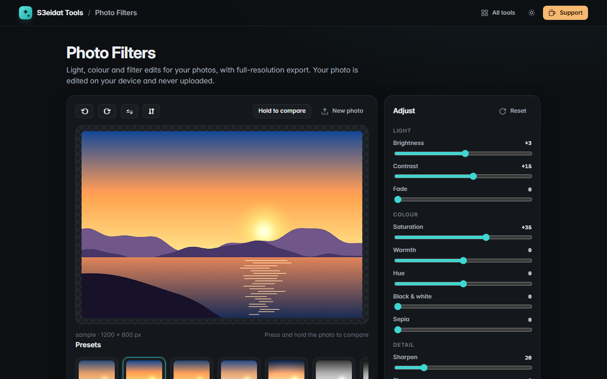

# Photo Filters

> Quick photo edits: light, colour and filters. Free, private, and it runs entirely in your browser.

### ▶ [Open Photo Filters](https://s3eidat.github.io/photo-filters/)



## Features

- **Light:** brightness, contrast, fade
- **Colour:** saturation, warmth, hue, black & white, sepia
- **Detail:** sharpen (unsharp mask), blur, vignette
- **11 presets** with live thumbnails of your own photo (Vivid, Warm, Cool, Drama, Mono, Noir, Vintage, Faded, Soft, Sunset)
- **Rotate** left/right and **flip** horizontally/vertically
- **Hold to compare** with the original (button, press and hold the photo, or hold the `\` key)
- **Export at full resolution** as JPG (with quality) or PNG
- Drop, choose or **paste** (Ctrl+V) a photo; double-click a slider to reset it

The preview is edited at screen size for speed; the export applies the same edits to the full-size photo.
Exported files don't carry over metadata (EXIF, GPS location), which is usually what you want when sharing.

## Privacy

Your photo never leaves your device: every pixel is processed by JavaScript in this page. There is no server,
no account, no analytics. The page ships with a strict Content-Security-Policy (`connect-src 'self'`),
so the browser itself blocks any attempt to send data anywhere.

## Run it yourself

It's plain HTML, CSS and JavaScript with no build step:

```bash
git clone https://github.com/s3eidat/photo-filters
cd photo-filters
python -m http.server 8000
```

Then open http://localhost:8000.

## Support

If this saved you time, **[buy me a coffee ☕](https://s3eidat.github.io/coffee/)**. It keeps every tool free.

---

Part of **[S3eidat Tools](https://s3eidat.github.io/)**: 100+ free, private tools that run in your browser. MIT licensed.
